# Commonly Used Intelligent Optimization Algorithms Improvement Strategies - Flight of Passage Chapter (Five Strategies) Can be used to improve all intelligent algorithms, making even beginners capable of improving intelligent algorithms.

This article will discuss the common intelligent optimization algorithm improvement strategies - flight-walking, which includes five commonly used improvement strategies:  
1. Levy Flight, 2. Random Walk, 3. Spherical Flight, 4. Gaussian Random Walk, 5. Triangular Walk  
These strategies can be easily adapted to other intelligent algorithms!  
To facilitate a deeper understanding of these five improvement strategies, the author has applied them in a simple yet easy-to-understand Particle Swarm Optimization (PSO) algorithm, teaching how to use these strategies and making it easier for others to adapt them to other intelligent algorithms in the future.  
1. Levy Flight  
Levy flight is characterized by both randomness and exploration, being a non-Gaussian stochastic process. Its stationary increment follows a Levy stable distribution, with its flight trajectory consisting of random walks, where small steps (short distances) are made up of short-range jumps that aggregate together, and occasional large steps (long distances) are made up of long-range jumps. These two types of jumps alternate.  
Levy flight is a very common improvement strategy for intelligent optimization algorithms and can be easily adapted to other algorithms. The specific formula for Levy flight is as follows:  
Reference: Xi Jinming, Zheng Rongyan. An improved Eulerian seagull optimization algorithm based on adaptive weights and Levy flight [J/OL]. Computer Systems Application: 1-9 [2023-10-23]. DOI: 10.15888/j.cnki.csa.009326.  
2. Random Walk  
The random walk strategy is a mathematical statistical model representing unordered motion resulting in movement trajectories. The main process involves randomly selecting a neighbor point within the current solution's neighborhood for comparison. If the new point is better than the current one, it becomes the new center. If no better value is found after N consecutive comparisons, the optimal solution is considered to be within a N-dimensional sphere centered at the current optimal solution with a step size equal to the radius. If the step size has already decreased below a threshold, the algorithm ends; otherwise, the step size is reduced by half and a new round of random walk begins. During iterations, when certain conditions are met, the probability distribution converges, eventually leading to a stable probability distribution.  
The formula for random walk strategy is as follows:
1. Random function r(t) as shown in the equation:
Due to the action trajectory of intelligent algorithms having a certain range, it cannot be directly updated by the above equation to update the position of the algorithm. To ensure that the algorithm walks within a certain range, normalization is needed, as shown below.
In the formula: Xit represents the position of the ith sparrow at the tth iteration; αi and bi are the minimum and maximum values of the random walk variable in the i-th dimension respectively; ci and di are the minimum and maximum values of the random walk variable in the i-th dimension respectively at the tth iteration.
References: Ma Xiaojing, He Hang, Wang Hongjun et al. A maximum entropy segmentation method based on improved sparrow search algorithm [J]. Science and Technology and Engineering, 2023, 23(16): 6983-6992.
③Spiral flight (search)
The spiral search was introduced in whale optimization algorithm and later applied by scholars to improve intelligent algorithms. The spiral search can enhance the global optimization ability of the algorithm, not only ensuring the convergence speed of the algorithm but also increasing individual diversity. The spiral search formula is as follows:
References: MIRJALILI S, LEWIS A. The whale optimization algorithm [J]. Advances in Engineering Software, 2016, 95:51-67.
④Gaussian random walk
As a classic model in the random walk model, the Gaussian random walk model has excellent development capability. The Gaussian random walk strategy is often used in the improvement of intelligent algorithms, different from random walk, the Gaussian random walk adds a Gaussian mutation formula to the random walk, resulting in a series of sequences around the best value of the population, the specific formula is as follows:
References: Li Zicheng, Dai Yongqiang. An improved whale optimization algorithm [J]. Computer Technology and Development, 2023, 33(02):173-180.
⑤Triangular walking strategy
Triangular Moving Strategy is a type of intelligent optimization algorithm where the population moves around while approaching the optimal position. To a certain extent, it enhances the local optimization capability of the algorithm. The formula is as follows:
Firstly, obtain the distance L1 between the population and the prey, and the range of swarming step length is L2.
Subsequently, the direction of walking is defined according to the following formula.
The following formula is used to calculate the position obtained after the population has migrated.
Results display
The CEC2005 function set is demonstrated, with 1000 iterations and a population size of 100.
PSO stands for Particle Swarm Optimization, Triangle_Walk_PSO represents the Triangle Walk Strategy, Spiral_flight_PSO denotes the Spiral Flight Strategy, randwalk_PSO is the Random Walk Strategy, Levy_flight_PSO is the Levy Flight Strategy, and Gaussian_randwalk_PSO is the Gaussian Random Walk Strategy.
Code display
Simply run the MAIN.m script file!

## Images

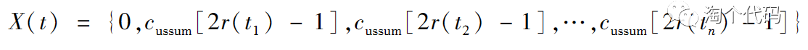

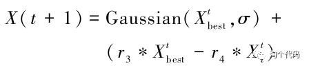
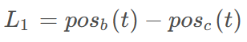

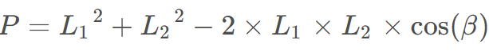

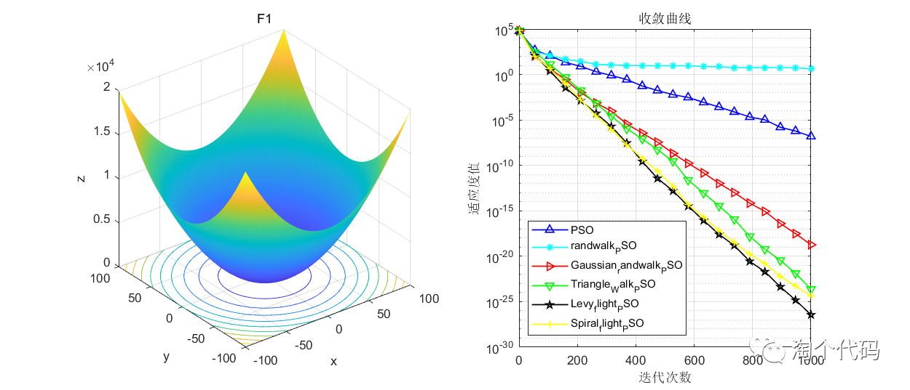
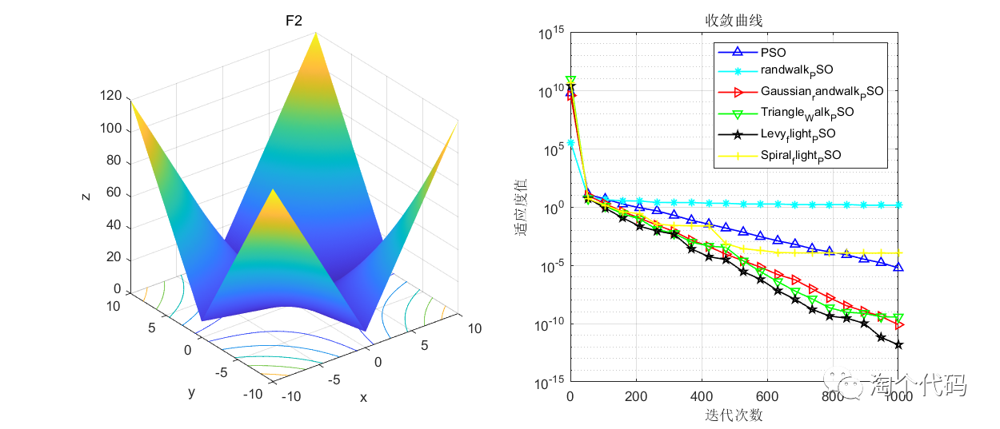
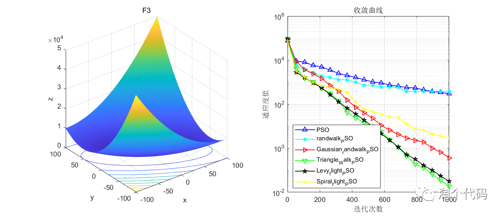

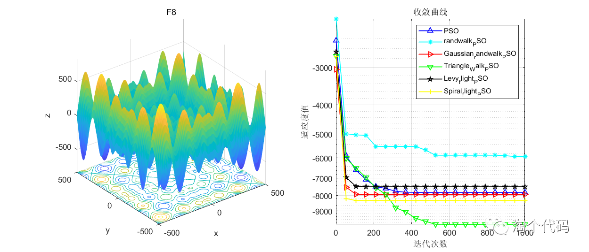
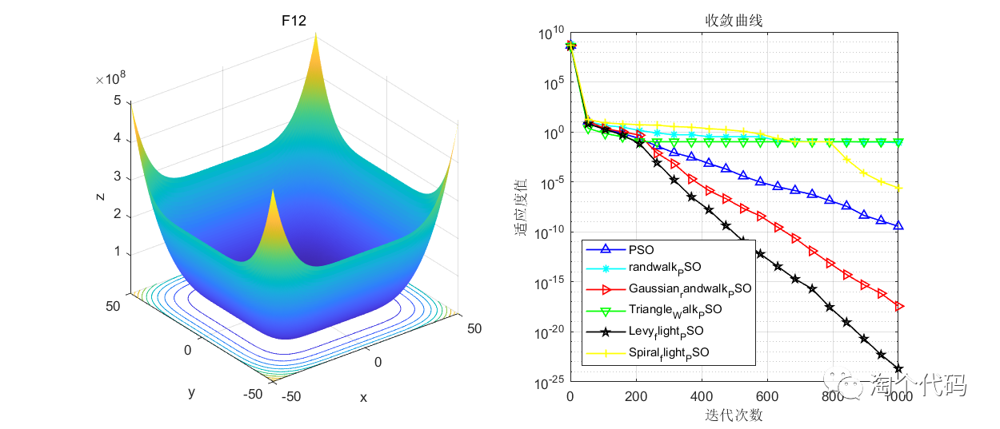
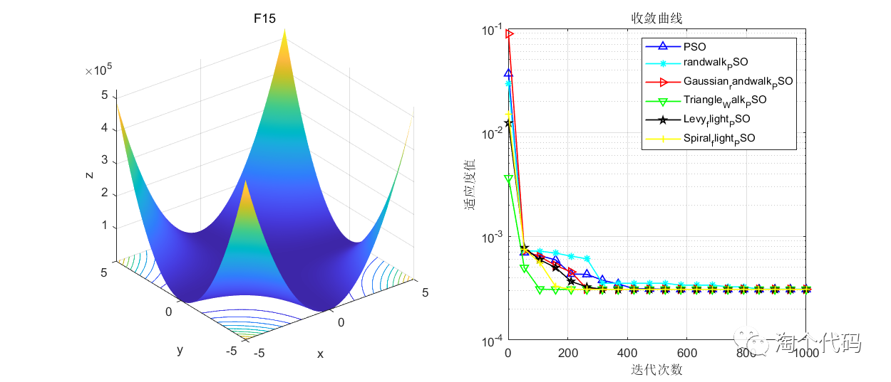
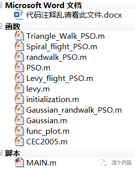

<!-- PAYMENT_BLOCK -->

## Get this dataset

- Payment link (Stripe): [Buy now](https://buy.stripe.com/3cs8yP7sY87d0vu9AB)
- Payment QR code: 

<!-- /PAYMENT_BLOCK -->
